# Assignment 6 — Deploy the Book Review App with Docker Compose

**Status — 15 October 2026: local implementation and testing complete; public deployment, the exact developer-tools screenshot and assignment-specific publication remain pending.**

Codex implemented and ran the tests under Eze Favour's authorization. The [13-check local integration report](evidence/2026-10-15-rubric/bookreview-tests.json), [actual execution log](evidence/2026-10-15-rubric/bookreview-tests.log), and [browser-review restart log](evidence/2026-10-15-rubric/browser-review-restart.log) distinguish local results from cloud evidence. No personal manual execution or external grade is invented.

Part of the DevOps Micro Internship (DMI) with Agentic AI

---

## Purpose

In this assignment, you will deploy the Book Review Application with Docker Compose using MySQL, a backend API, and a frontend user interface. You will configure health-gated startup, browser-facing API access, CORS, and persistent MySQL storage.

---

# Task 1 — Prepare the Project

## Goal

Prepare your fork of the Book Review App repository for Docker Compose deployment.

### Evidence

#### Screenshot 1 — Project Structure

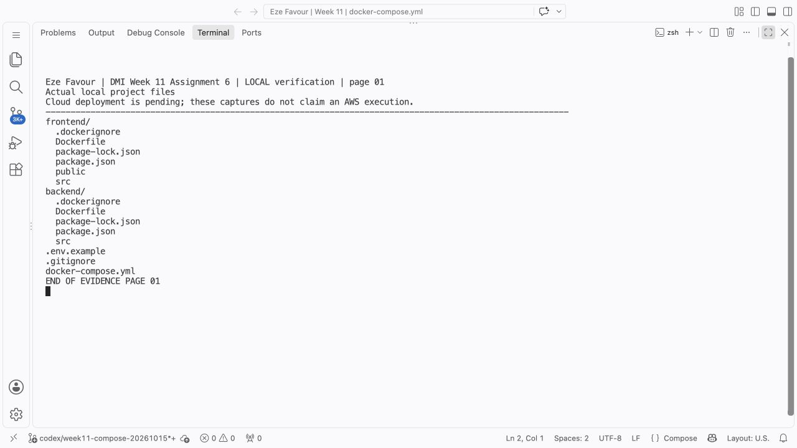

**Eze Favour — local Docker Desktop execution, 15 October 2026.** Direct terminal capture of the actual project source/file listing. Environment examples contain no real secret values.

---

#### Screenshot 2 — Environment and Docker Ignore Files

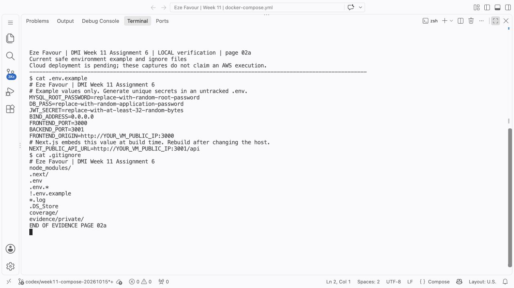

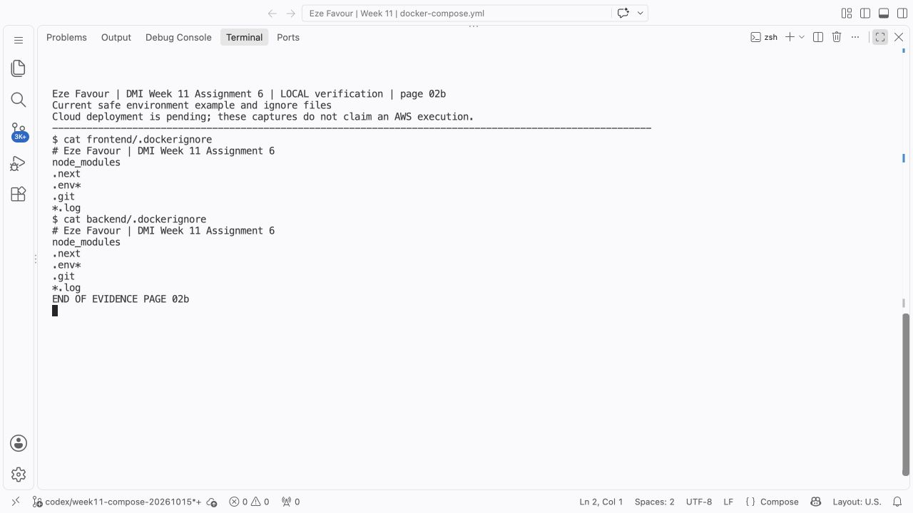

**Eze Favour — local Docker Desktop execution, 15 October 2026.** Direct terminal capture of the actual project source/file listing. Environment examples contain no real secret values.

---

# Task 2 — Create or Confirm Application Dockerfiles

## Goal

Prepare Dockerfiles for the frontend and backend services and build both services through Docker Compose.

### Evidence

#### Screenshot 3 — Frontend Dockerfile

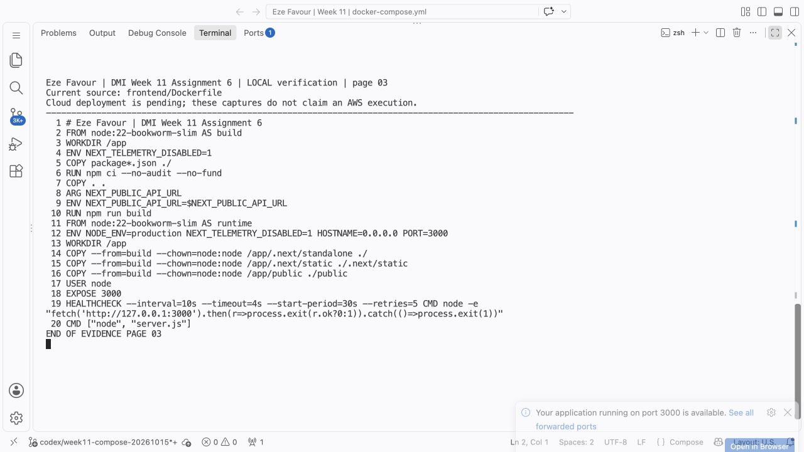

**Eze Favour — local Docker Desktop execution, 15 October 2026.** Direct terminal capture of the actual project source/file listing. Environment examples contain no real secret values.

---

#### Screenshot 4 — Backend Dockerfile

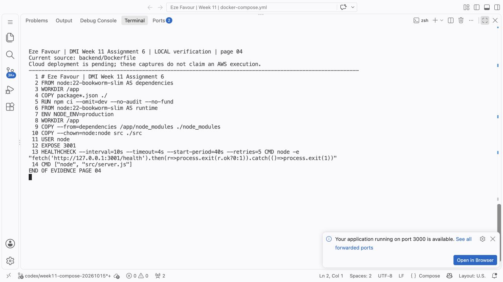

**Eze Favour — local Docker Desktop execution, 15 October 2026.** Direct terminal capture of the actual project source/file listing. Environment examples contain no real secret values.

---

#### Screenshot 5 — Docker Compose Build

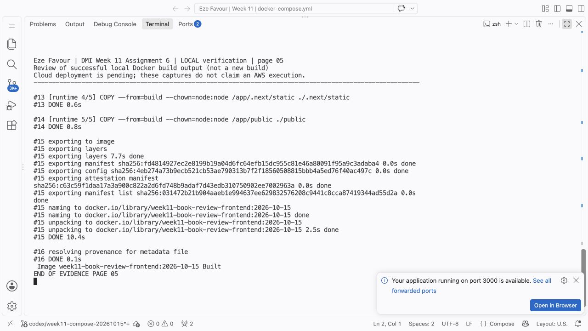

**Eze Favour — local Docker Desktop execution, 15 October 2026.** The terminal displays the dated saved command output from the actual local run; it is an evidence review, not a claim that the commands were re-executed while the screenshot was taken.

---

# Task 3 — Create the Docker Compose Stack

## Goal

Create one `docker-compose.yml` file that builds and runs MySQL, backend, and frontend services.

### Evidence

#### Screenshot 6 — MySQL Service, Health Check, and Volume Mount

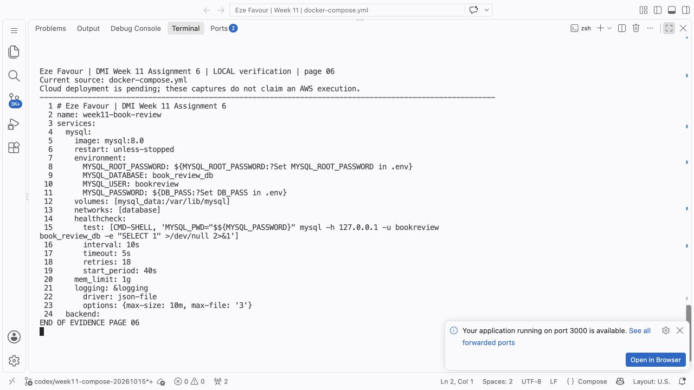

**Eze Favour — local Docker Desktop execution, 15 October 2026.** Direct terminal capture of the actual project source/file listing. Environment examples contain no real secret values.

---

#### Screenshot 7 — Backend Configuration

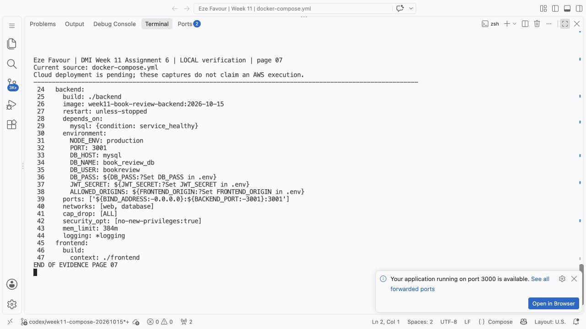

**Eze Favour — local Docker Desktop execution, 15 October 2026.** Direct terminal capture of the actual project source/file listing. Environment examples contain no real secret values.

---

#### Screenshot 8 — Frontend Configuration

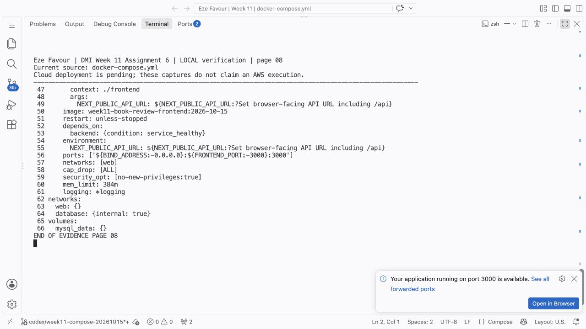

**Eze Favour — local Docker Desktop execution, 15 October 2026.** Direct terminal capture of the actual project source/file listing. Environment examples contain no real secret values.

---

#### Screenshot 9 — Named Volume Definition

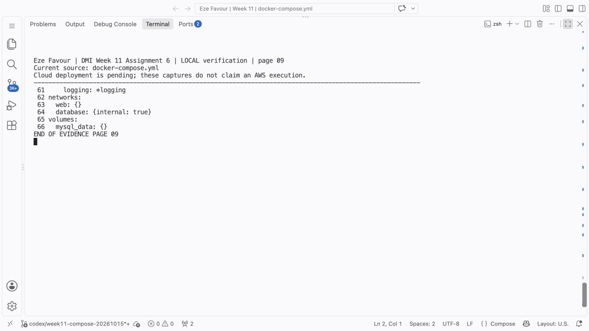

**Eze Favour — local Docker Desktop execution, 15 October 2026.** Direct terminal capture of the actual project source/file listing. Environment examples contain no real secret values.

---

# Task 4 — Start and Verify the Stack

## Goal

Build and start all services through one Docker Compose workflow.

### Evidence

#### Screenshot 10 — Docker Compose Service Status

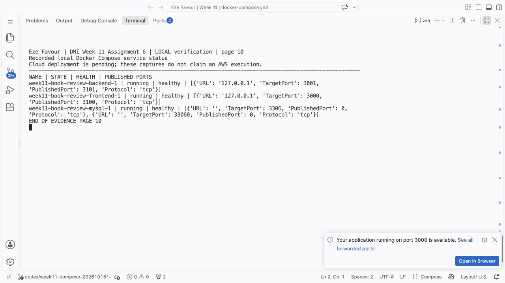

**Eze Favour — local Docker Desktop execution, 15 October 2026.** Terminal review of the recorded local service/log output.

---

#### Screenshot 11 — MySQL and Backend Logs

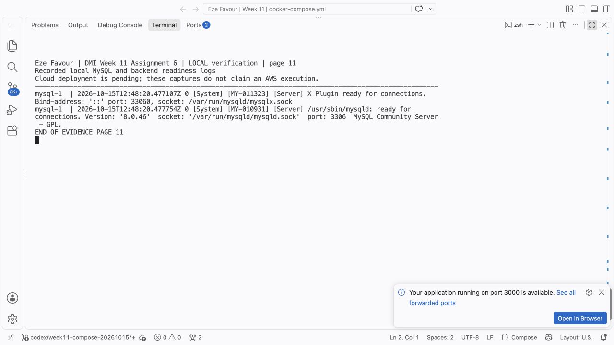

**Eze Favour — local Docker Desktop execution, 15 October 2026.** Terminal review of the recorded local service/log output.

---

# Task 5 — Test End-to-End Application Functionality

## Goal

Verify that the Book Review App works through the browser.

### Evidence

#### Screenshot 12 — Successful Registration or Login

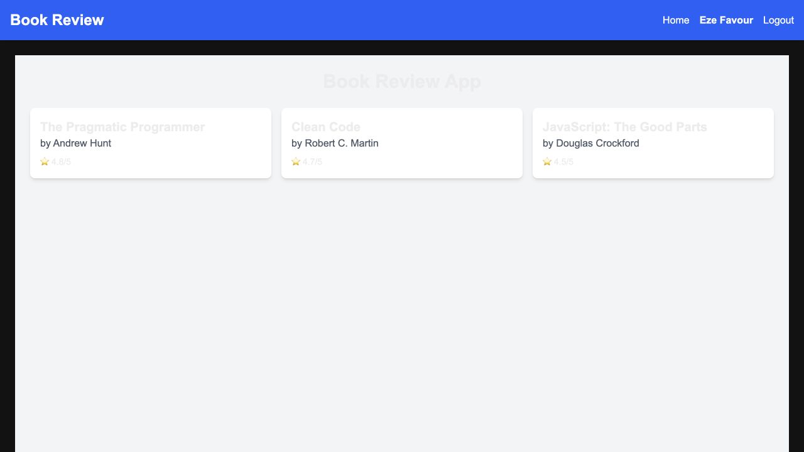

**Eze Favour — local Docker Desktop execution, 15 October 2026.** Direct browser capture. Registration/login and review submission were performed through the UI. The same browser-created review remains after the down/up cycle.

---

#### Screenshot 13 — Created Book Review

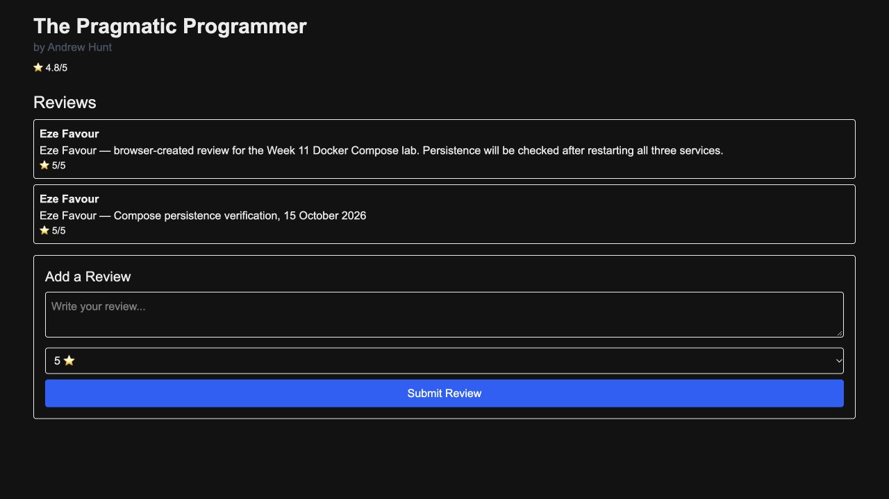

**Eze Favour — local Docker Desktop execution, 15 October 2026.** Direct browser capture. Registration/login and review submission were performed through the UI. The same browser-created review remains after the down/up cycle.

---

#### Screenshot 14 — CORS Verification

[Captured browser network responses and console check](evidence/2026-10-15-rubric/browser-cors.json) show API preflights **204**, API reads **200**, the correct allowed frontend origin, and **zero new browser console errors**. This is actual CDP/network evidence. The specifically requested developer-tools Network + Console screenshot remains outstanding; this JSON is not labelled as that screenshot.

---

# Task 6 — Prove MySQL Data Persistence

## Goal

Verify that MySQL data remains after a non-destructive Docker Compose down/up cycle.

### Evidence

#### Screenshot 15 — Data Before Restart

**Eze Favour — local Docker Desktop execution, 15 October 2026.** Direct browser capture. Registration/login and review submission were performed through the UI. The same browser-created review remains after the down/up cycle.

---

#### Screenshot 16 — Non-Destructive Stack Restart

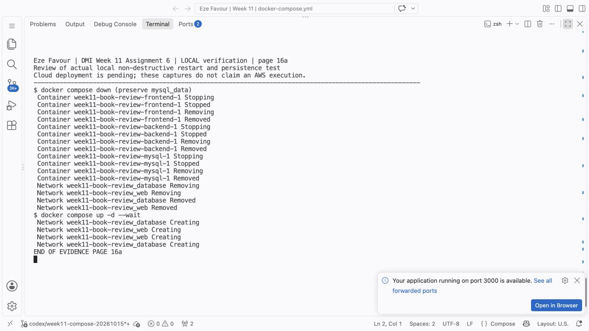

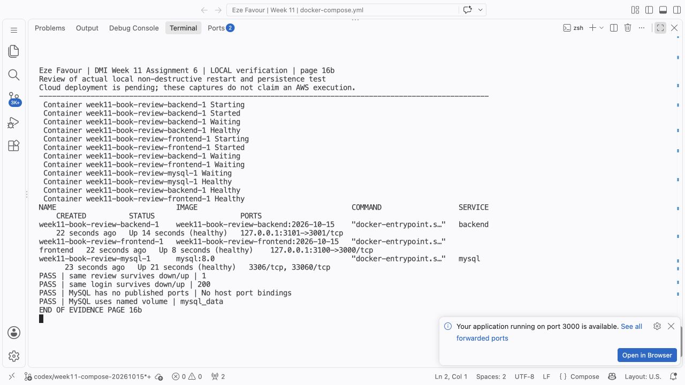

**Eze Favour — local Docker Desktop execution, 15 October 2026.** The terminal displays the dated saved command output from the actual local run; it is an evidence review, not a claim that the commands were re-executed while the screenshot was taken.

---

#### Screenshot 17 — Data After Restart

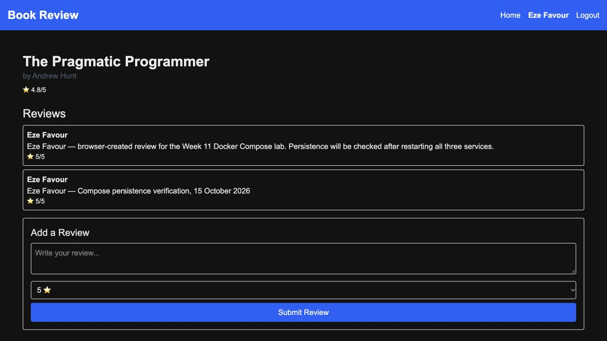

**Eze Favour — local Docker Desktop execution, 15 October 2026.** Direct browser capture. Registration/login and review submission were performed through the UI. The same browser-created review remains after the down/up cycle.

---

# Task 7 — Explain Docker Compose Teardown Modes

## Goal

Explain the difference between preserving data and fully resetting a Docker Compose environment.

### Notes

`docker compose down` removes this project's containers and networks while preserving named volumes.
MySQL stores its data in `mysql_data`, independently of container lifetimes.
A subsequent `docker compose up -d` reuses that volume, including the same users and reviews.
Removing the volume destroys those records; an image rebuild cannot recover them.
A full reset is appropriate only for a disposable environment or an intentional database reset.
Capture persistence proof and a verified backup before any destructive reset.

---

# Final Public Frontend URL

**Local verified frontend:** http://127.0.0.1:3100/

**Public frontend:** not deployed in this revision. Cloud access became unavailable before deployment. The prepared configuration uses the VM public IP with ports 3000/3001; a planned address is not presented as working evidence.

---

# GitHub Repository URL

**Fork:** https://github.com/Favourcloud/book-review-app

---

# LinkedIn Requirement

## Goal

Create a LinkedIn post about the Book Review App deployment and what you learned from using Docker Compose.

### Evidence

**Assignment-specific LinkedIn post:** pending a verified public deployment. The existing Week 11 post predates this newly added Compose assignment and is not claimed as its publication.

#### LinkedIn Post Screenshot

No assignment-specific publication capture yet. A draft will be completed with the verified public deployment results.

---

# Submission Checklist

- [x] Book Review App repository forked and used
- [x] `.env` excluded from Git tracking
- [x] `.env.example` contains only safe placeholder values
- [x] Frontend and backend Dockerfiles created or confirmed
- [x] MySQL health check configured
- [x] Backend waits for healthy MySQL
- [x] Backend uses `mysql` as the database hostname
- [ ] Frontend API URL uses the VM public IP and backend port
- [x] Backend CORS origin matches the frontend origin
- [x] MySQL port 3306 is not publicly exposed
- [x] Registration and login work
- [x] Book review creation works
- [x] Data persists after a non-destructive down/up cycle
- [ ] Screenshots 1–17 included
- [x] Teardown explanation completed
- [ ] Public frontend URL included
- [x] GitHub repository URL included
- [ ] LinkedIn post URL and screenshot included
- [x] Full name visible in required terminal screenshots
- [x] Browser screenshots include a full-name caption
- [x] No sensitive information exposed

---

## 📌 About DMI & CloudAdvisory

DevOps Micro Internship (DMI) is a project-based DevOps program run by Pravin Mishra (The CloudAdvisory) focused on real-world execution, systems thinking, and career readiness.

It helps learners build strong DevOps foundations with hands-on experience.

---

## 📌 Resources

- 🌐 DMI Official Website: https://dmi.pravinmishra.com?utm_source=github&utm_medium=readme
- 🎓 University: https://university.pravinmishra.com?utm_source=github&utm_medium=readme
- 💬 Discord Community: https://discord.pravinmishra.com?utm_source=github&utm_medium=readme
- 📝 Blog: https://dmi.pravinmishra.com/blog?utm_source=github&utm_medium=readme
- ▶️ YouTube Playlist: https://www.youtube.com/playlist?list=PLFeSNDtI4Cho
- 🔗 Pravin Mishra (LinkedIn): https://www.linkedin.com/in/pravin-mishra-aws-trainer/
- 🏢 CloudAdvisory (LinkedIn): https://www.linkedin.com/company/thecloudadvisory/

---

*This submission is part of DevOps Micro Internship (DMI) — Agentic AI Track.*
